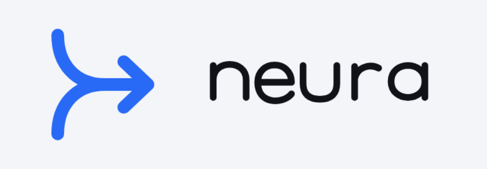
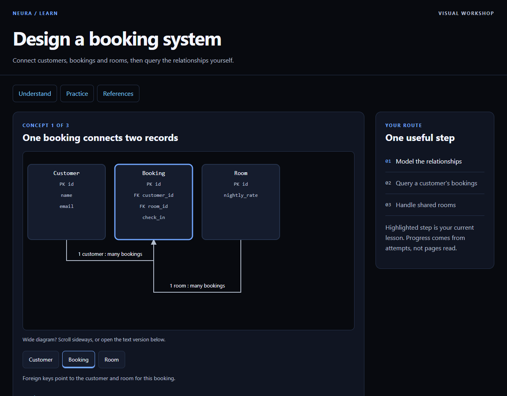
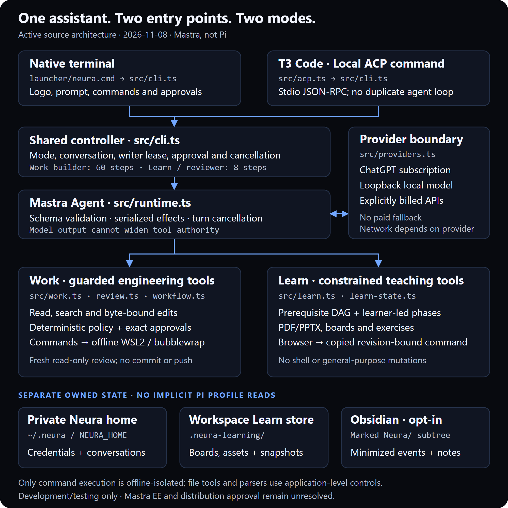

<p align="center"><picture><source media="(prefers-color-scheme: dark)" srcset="assets/brand/neura-logo-dark.png"></picture></p>

# Neura

**Context into action.** A Windows-first terminal assistant for engineering and practical learning.

Neura brings two modes into one CLI: **Work** reads and searches a project, makes edits, then runs tests.
**Learn** turns concepts and local documents into cited lessons,
diagrams and exercises. The active application uses **Mastra, not Pi**.

> **Development/testing only, not a production release.** Use synthetic,
> non-sensitive projects and materials. Mastra EE scope and distribution approval
> remain unresolved. Local development acceptance does not authorize processing
> end-user, customer or business-operational data, redistribution or production use.

[Documentation](docs/README.md) · [Quick start](#quick-start-from-source) ·
[Architecture](docs/ARCHITECTURE.md) · [T3 Code](docs/T3_CODE.md) ·
[Current status](docs/STATUS.md) · [Security](SECURITY.md)

## A look inside Learn



*Native Edge capture at 1280 × 1000 of the current Learn renderer with synthetic
teaching data—not a live provider session or a real PDF import.
[Visual tour](docs/LEARN_MODE.md#visual-tour) · [Capture provenance](assets/screenshots/README.md).*

## What Neura does

### Work

- Read and search workspace files with `read`, `ls`, `grep` and `find`.
- Create folders and make edits bound to original file bytes. Protected paths
  and changes whose redaction would hide content are restricted.
- Run permitted commands in network-disabled WSL2/bubblewrap. Policy-allowed
  build, test, validation and inspection commands run without a prompt when the
  workspace has a `.git` directory. Other permitted commands need exact typed
  approval. Missing isolation fails closed. No command runs on the host as a fallback.
- Review substantive Git changes with a fresh reviewer restricted to read-only
  tools. The builder can fix must-fix findings for up to three rounds. Review
  receipts become stale after later edits. The default reviewer follows the
  builder model and is labelled same-family. A different provider can be selected.

Work turns allow 60 model steps. A step-limit stop retains the starting baseline
so a later `continue` can review the whole task. Review requires a committed Git
baseline within snapshot limits. It never commits, pushes or merges.

### Learn

- Teach one concept with a diagram and example, then offer a practical exercise.
- Import workspace PDF/PPTX files, including bounded offline English OCR.
- Publish local HTML boards with page/slide citations and exercise feedback. Hints are available.
- Save progress explicitly and resume it in a later process. Restored source
  excerpts remain historical until the originals are reimported.
- Optionally capture minimized learning events in a configured Obsidian vault.

There is **no automatic browser synchronization**. Copy a board's revision-bound
command into the terminal to submit an answer. Reading or revealing an answer
does not establish mastery. See the [Learn guide](docs/LEARN_MODE.md).

## How it fits together



*DIAGRAM, not a product screenshot. [Editable SVG source](assets/diagrams/architecture.svg).*

T3 is another entry point into Neura, not a replacement agent loop. Work commands
run only in the offline sandbox; model inference uses the selected provider's
transport, which may use the network. Learn boards return actions through copied
commands, not a background connection. See the [source map and trust boundaries](docs/ARCHITECTURE.md).

## Project state

The current checkout is an unreleased Mastra development build. Package metadata
remains `2.6.0-rc.1`. “v1” in migration documents names the implementation, not a
published version. Mastra core is pinned to `1.79.0`.

The [latest published release, v2.5.1](https://github.com/Rajveerx11/neura/releases/tag/v2.5.1),
belongs to the historical Pi application. The existing `v2.6.0-rc.1` draft is
withheld. Neither describes an installable release of the current application.
See [release status](docs/releases/README.md) and the [parity matrix](docs/PARITY_MATRIX.md).

Recent source changes include the local T3 Code ACP adapter, active Learn pedagogy
and prerequisite paths (#154), real-project Work support (#152), Learn continuity
and vault hardening (#153), and package-closure gates (#151).
[Dated evidence](docs/MASTRA_V1.md) distinguishes
synthetic checks from recorded live tests and unresolved gates.

<a id="requirements"></a>

## Prerequisites

- Native Windows, PowerShell, Git, Node.js `24.15+` and npm. CI uses Node
  `24.16.0`. Recorded local testing used `24.19.0`.
- Both locked dependency graphs, installed with lifecycle scripts disabled.
- WSL2 and bubblewrap for Work commands. The selected distro's `/usr` toolchain
  must contain required tools. Home-directory installations such as nvm are
  hidden. `NEURA_WSL_DISTRO` selects a nondefault distro.
- A browser for Learn boards and optional subscription sign-in.
- A private Neura home outside the workspace. Inspect its Windows DACL before
  using real credentials. See [authentication](docs/CODEX_AUTH.md).

First Learn-store creation requires native Windows. Linux CI covers portable
contracts and does not establish a supported Linux installation. The optional
development launcher requires an ASCII-only checkout path. Setup does not
bootstrap Node, WSL, bubblewrap or a model server. No Pi installation is required.

## Quick start from source

```powershell
git clone https://github.com/Rajveerx11/neura.git
Set-Location .\neura
npm ci --ignore-scripts
npm ci --prefix agent/neura --ignore-scripts
node src/cli.ts --help
node src/cli.ts --check
```

`--help` and `--check` make no model requests. `--check` checks runtime loading
and Learn dependencies. It does not test provider access, DACLs or WSL execution.
Keep the clone's history: the parity suite reads a frozen baseline commit.

Optionally create a launcher that points at this checkout:

```powershell
powershell -NoProfile -File .\install.ps1 -Development
powershell -NoProfile -File .\install.ps1 -Check
Get-Command neura -All
```

This is a source-linked development install: uncommitted source edits affect the
next launch. It is not a sealed release or an automatic updater. The installer
preserves unknown/modified launchers and backs up receipt-owned replacements.
Without the launcher, use `node C:\path\to\neura\src\cli.ts` in place of `neura`.

For T3 Code, use the [local ACP development integration](docs/T3_CODE.md).
It keeps Neura's Work/Learn loop and sandbox; it is not a Pi provider or a release.

### Manual test in a disposable workspace

Use a project outside the Neura checkout and its ancestors/descendants, Neura's
private home and Pi profiles. For example, in a new terminal after installing the
optional launcher:

```powershell
$workspace = Join-Path $env:TEMP ("neura-smoke-" + [guid]::NewGuid())
New-Item -ItemType Directory -Path $workspace | Out-Null
'alpha' | Set-Content -Encoding utf8 -Path (Join-Path $workspace 'sample.txt')
neura --cwd $workspace --check
neura --cwd $workspace --provider openai-codex --no-history
```

The default provider is ChatGPT subscription. After inspecting credential-home
DACLs, enter `/login` only when you intend to authorize Neura. Open the displayed
URL yourself. With an existing login, `/model` opens the subscription catalog.
Without an explicit model, the first task selects its first picker-visible model
by provider priority. Catalog visibility does not prove model entitlement.

The owner has reported working subscription responses and recorded live Work
tests. Automated authentication checks remain synthetic. Complete scope,
refresh/restart and entitlement acceptance remain open. Keep authorization URLs,
callbacks, tokens and raw provider responses private.

For an already running loopback OpenAI-compatible model, select it explicitly:

```powershell
neura --cwd $workspace --provider local --model qwen3-coder --base-url http://127.0.0.1:8080/v1 --no-history
```

Use the model ID advertised by your server. Neura does not start or download it.
`openai` and `anthropic` explicitly select separately billed APIs using
`OPENAI_API_KEY` or `ANTHROPIC_API_KEY`. Subscription failures never fall back to
API billing. See [provider setup](docs/CODEX_AUTH.md).

In Work, ask Neura to read `sample.txt`, then create `result.txt` containing
`beta`. Inspect the files yourself. For sandbox acceptance, use a disposable
project with a committed Git baseline and run the configured-host check below.
Install project dependencies manually in WSL: Neura's command sandbox is offline
and refuses common install commands.

To try Learn:

```text
/mode learn
Teach one concept about database joins. Show a diagram and an example, then give me one exercise.
/learn answer <your answer>
/learn hint
/learn save
/learn saved
/learn resume <progress-filename>
```

Bare interactive launch from your user home creates a temporary scratch workspace
and prints its path. For lasting work, launch in your project or pass `--cwd`.
Explicit workspaces, headless tasks and resumed sessions never silently switch.

## Commands

| Command | Purpose |
| --- | --- |
| `/help`, `/status` | Commands, provider, workspace, history and reported last-turn usage |
| `/mode work`, `/mode learn` | Select either implemented mode |
| `/model`, `/model PROVIDER MODEL [URL]` | Subscription picker or explicit provider/model selection |
| `/login`, `/logout` | Explicit subscription authorization or local credential removal |
| `/thinking on\|off` | Toggle provider-supplied reasoning summaries |
| `/workflow on\|off` | Toggle automatic Work review |
| `/review`, `/review status` | Review session changes or check receipt currency |
| `/reviewer PROVIDER MODEL [URL]`, `/reviewer default` | Select a reviewer or follow the builder |
| `/verify quick`, `/verify full`, `/verify status` | Request bounded verification or inspect its receipt |
| `/new`, `/sessions`, `/resume <id>` | Workspace-scoped conversation history |
| `/learn` | Lesson controls and answer submission, plus explicit progress recovery |
| `/quit`, `/exit` | Close Neura. Bare interactive `quit` and `exit` also work |

Ctrl+C cancels a running turn. `--prompt "TASK"` runs a headless task. Headless
requests cannot grant approvals. Policy-allowed sandbox commands can still run
without approval. `--no-history` disables conversation persistence, not credential
or Learn-artifact writes. Model changes start a fresh conversation.

### Manual verification: first integration slice

`/verify quick` requests pinned PoW `0.2.0` in the offline WSL proof sandbox after
interactive approval. It needs an exact Git root with committed HEAD and already
configured trusted proof artifacts. Missing prerequisites report `unavailable`.
`/verify full` and bare `/verify` remain unavailable because trusted full evidence
is missing. Receipts are session-local, exclude ignored files and always retain
`verified:false`. A detector result or review approval is not proof of completion.
See [verification](docs/VERIFICATION.md).

## Terminal experience

Interactive launch shows the approved logo, prompt-adjacent status and prompt.
Chat turns print the answer. Tool calls, approvals and meaningful review outcomes
stay visible. `/status` holds detailed usage. Provider-supplied reasoning summaries
are optional. Hidden reasoning is never displayed.

`--ascii`, `TERM=dumb` and narrow terminals use `>_ neura`. `NO_COLOR` disables
color. Headless requests, `--help` and `--check` omit artwork. See
[terminal UX](docs/TERMINAL_UX.md) and [brand assets](assets/brand/README.txt).

## Limits and data

History and credentials belong to `~/.neura` or explicit `NEURA_HOME`. Learn
boards and explicit snapshots use the workspace's owned `.neura-learning` store.
Optional Obsidian capture uses only its configured owned subtree. No legacy
Pi credentials, history or memory are imported automatically.

Work commands protect `.git`, `.github`, `.husky` and `.vscode` at any depth and
mask secret-named files. Gitfiles, including linked-worktree Git roots, are
refused for commands. Git-ignored files without secret names can remain readable
to commands. Review generated code before running it on the host. Application
path checks do not isolate against a hostile process under the same user.

Plan, YOLO, Human Away, delegation, LSP/MCP, `/ship`, the old cockpit and context
compaction are unavailable in the current application. Learn/reviewer turns keep
an eight-step bound. Crash locks fail closed. Durable effect recovery is unfinished.
Legacy source is retained as migration evidence. Human Away remains preview-only
in that historical source and is unavailable in the active CLI.

Exit Neura before changing its source or launcher. Roll back by selecting a
known-good checkout or restoring a verified installer-owned launcher backup.
Preserve dirty worktrees, credentials, history, approval records and vaults, along with recovery
backups. See [installer limits](docs/INSTALLER_READINESS.md).

## Verify and contribute

```powershell
npm run verify
npm run test:browser:learn
git diff --check
```

`npm run verify` includes strict types, the Pi-free/dependency-closure gate,
22 active suites (including ACP) and registered documentation checks. Tests use
synthetic state. Default verification does not require a successful live WSL
command. Edge is needed for the separate Learn browser check. In a shallow clone,
fetch full history before verification with `git fetch --unshallow`.

On a configured native Windows/WSL2/bubblewrap host, also run:

```powershell
npm run test:v1:work-sandbox
npm run verify:sandbox
```

PR CI keeps required `harness` and `portable-proof` checks, audits both dependency
graphs, and runs browser/security contracts. `verify:release` deliberately fails
while license/distribution approval remains unresolved. A green suite does not
clear that gate. Read the [development guide](docs/DEVELOPMENT.md) and
[contribution rules](CONTRIBUTING.md). Future publication follows the
[release policy](docs/RELEASING.md).

## License

Neura source is licensed under [Apache-2.0](LICENSE). Third-party dependencies
retain their own terms, including the unresolved Mastra EE/distribution scope.
The current logo's trademark clearance and redistribution terms remain
undocumented. See [brand asset notes](assets/brand/README.txt). Maintained by
[Rajveerx11](https://github.com/Rajveerx11).
