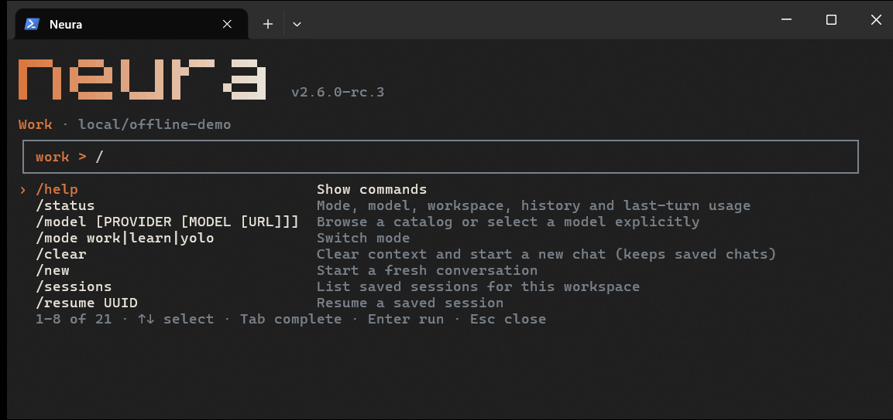

<p align="center">
  <picture>
    <source media="(prefers-color-scheme: dark)" srcset="assets/brand/neura-logo-dark.png">
    
  </picture>
</p>

# Neura

Neura is a Windows-first terminal agent for coding and practical learning. **Work**
reads and edits your project, runs commands in an offline sandbox, and reviews
changes. **Learn** turns local documents and questions into cited lessons and
exercises. Neura runs its own agent loop, with neither Mastra nor Pi.

[Documentation](docs/README.md) · [Usage](docs/USAGE.md) · [T3 Code](docs/T3_CODE.md) ·
[Changelog](docs/CHANGELOG.md) · [Security](SECURITY.md)

> The current application is a source-linked development build, not a production release.
> Use synthetic, non-sensitive data. The latest [published release](docs/releases/README.md),
> `v2.5.1`, is the older Pi-based app. `2.6.0-rc.1` is the current version label,
> but its release draft is withheld.

## Quick start from source

Use native Windows, PowerShell, Git and Node.js 24.15 or newer. Work commands also
need WSL2 with bubblewrap and the project toolchain installed in the distro. Neura
sets up none of these prerequisites for you.

```powershell
git clone https://github.com/Rajveerx11/neura.git
Set-Location .\neura
npm ci --ignore-scripts
npm ci --prefix agent/neura --ignore-scripts
powershell -NoProfile -File .\install.ps1 -Development
powershell -NoProfile -File .\install.ps1 -Check
```

The launcher points to this checkout. No global npm package, Pi profile or
updater is installed. If `neura` is not on `PATH`, run
`& "$HOME\.local\bin\neura.cmd"`. To skip the launcher, use `node src/cli.ts`.
See [how to update an existing install](docs/INSTALLER_READINESS.md#update-a-source-linked-install)
and [installer limits](docs/INSTALLER_READINESS.md).

Open Neura in a project outside the Neura checkout and its private home:

```powershell
neura --cwd C:\path\to\project
```

ChatGPT subscription is the default provider. `/login` starts sign-in and
`/model` opens the model picker. Before using real credentials, check the
[private home permissions](docs/CODEX_AUTH.md#before-a-manual-subscription-test).
For local inference, OpenAI, Anthropic or gateways, see [providers](docs/USAGE.md#providers).

Type `/` to browse commands or `$` to browse installed skills. Start a line
with `!` to run your own shell command in the workspace, such as `!git status`.
The prompt box turns pink and reads `shell >` while the line is a command. It runs
as you, outside the sandbox, and its output joins the conversation. Start a new
conversation with `/new`; saved chats remain available through `/sessions`.



[More terminal screenshots and capture details](assets/screenshots/README.md#native-terminal-captures).

## What Neura does

- **Work:** Edit with original-byte checks, run permitted commands in WSL2/bubblewrap,
  and review Git changes with read-only tools. Missing isolation blocks execution.
  Neura never falls back to host execution or commits, pushes or merges for you in Work.
- **Learn:** Switch with `/mode learn`. Import PDF, PPTX and text sources, practice on
  local HTML boards, and save with `/learn save`. There is no automatic browser synchronization.
  Restore with `/learn resume`; reimport originals before using citations again.
  See the [Learn guide](docs/LEARN_MODE.md).
- **Skills and schedules:** Apply a skill with `$NAME TASK`, or schedule supervised
  Work in the current terminal. Neither adds permissions. See [skills](docs/SKILLS.md)
  and [schedules](docs/USAGE.md#loops-and-schedules).
- **T3 Code:** Register Neura as a local ACP command. Use a standalone Git checkout
  in T3 Local mode if Work needs to run shell commands. See [T3 setup](docs/T3_CODE.md).

### YOLO

`neura --yolo` grants full host access: no sandbox, no approvals, and network access.
Inside Neura, `/mode yolo` requires explicit confirmation. Secrets the agent reads
may reach the model provider or saved history. Use it only on trusted projects.
See [YOLO behavior](docs/USAGE.md#yolo) and the [security policy](SECURITY.md#yolo-has-no-boundary).

## Development

See [Development](docs/DEVELOPMENT.md) for source setup and
[Contributing](CONTRIBUTING.md) before opening an issue or PR.

```powershell
npm run verify
git diff --check
```

These checks cover repository policy, types, dependencies and docs. They do not
run runtime regressions. See [Verification](docs/VERIFICATION.md) and
[open release gates](docs/PRODUCTION_READINESS.md).

## License

[Apache-2.0](LICENSE). Third-party dependencies retain their own terms. See
[NOTICE](NOTICE) and the [brand asset notes](assets/brand/README.txt).
