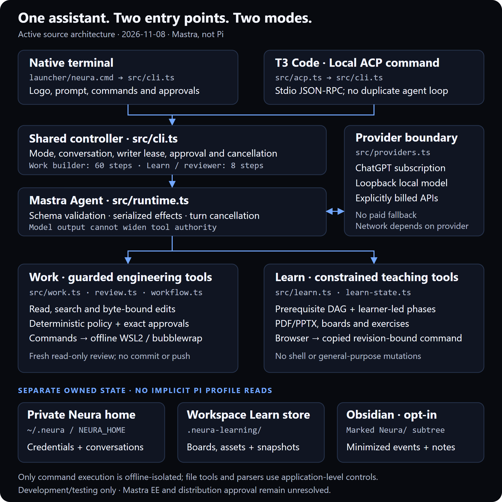

# Architecture

Updated 2026-11-08 against the active Mastra Work/Learn source through `efdbde3`,
including the local T3 Code adapter. This is a source-linked development application,
not a production release or full ACP implementation. [Release and licensing gates](STATUS.md) remain
open. Retained Pi extensions are historical evidence, outside the active import graph.

## System overview

*DIAGRAM, not a product screenshot. [Editable SVG source](../assets/diagrams/architecture.svg).*

Read the diagram from top to bottom:

1. The native launcher and T3's local ACP command enter the **same controller**.
2. Mastra handles model turns; Neura validates and serializes tool effects.
3. The current mode determines tool authority. Model output cannot widen it.
4. Credentials, learning artifacts and optional vault events have separate owners.

The arrows summarize control flow, not every disk or network operation. Only Work
command execution uses offline OS isolation. Host-side file tools and Learn parsers
use application-level controls. Model transports can use the network. The editable
[SVG source](../assets/diagrams/architecture.svg) contains no scripts or remote assets.

## Entry points and shared runtime

`launcher/neura.cmd` starts `src/cli.ts`. Interactive startup shows the approved
logo, prompt-adjacent status and prompt; headless and ACP output omit artwork.
`src/acp.ts` bridges newline-delimited JSON-RPC to that same CLI through its injected
I/O/controller interface. There is no second agent loop or Pi profile lookup.

The controller owns provider selection, mode, conversation history, session locks,
approval input and cancellation. `src/runtime.ts` wraps a real Mastra Agent with
schema validation, serialized effects and cancellation. Work builders have a
60-step bound; Learn and reviewers have an eight-step bound.

| Source | Responsibility |
| --- | --- |
| [`src/cli.ts`](../src/cli.ts) | Startup, commands, generation fences and turn orchestration |
| [`src/yolo.ts`](../src/yolo.ts) | YOLO host tools and process-tree kill: no sandbox, approvals or path policy |
| [`src/acp.ts`](../src/acp.ts) | T3 transport, Work/Learn/YOLO mode mapping, streamed updates, permission requests and disconnect cleanup |
| [`scripts/register-t3.mjs`](../scripts/register-t3.mjs) | Scoped, serialized local registration; metadata check and real discovery probe |
| [`src/brand.ts`](../src/brand.ts), [`src/terminal-ui.ts`](../src/terminal-ui.ts) | Approved launch mark, width-aware status/help and plain-text fallbacks |
| [`src/providers.ts`](../src/providers.ts), [`src/auth.ts`](../src/auth.ts) | Separate subscription, loopback local and explicitly billed API transports; explicit login/logout |
| [`src/work.ts`](../src/work.ts) | Guarded workspace tools, byte-bound mutations, project guidance and command admission |
| [`src/review.ts`](../src/review.ts), [`src/workflow.ts`](../src/workflow.ts) | Read-only review, risk routing, receipt currency and bounded builder fixes |
| [`src/verification.ts`](../src/verification.ts) | Manual proof requests, trusted offline sandbox invocation and detector receipts |
| [`src/learn.ts`](../src/learn.ts), [`src/learn-state.ts`](../src/learn-state.ts) | Teaching tools, instructional phases, prerequisite paths, evidence identities and explicit recovery |
| [`src/session.ts`](../src/session.ts), [`src/session-lock.ts`](../src/session-lock.ts) | Workspace-keyed history and exclusive writer leases |

### T3 is a transport, not an authority bypass

T3 launches one Neura ACP process per thread. Normal sessions retain workspace
containment and Neura's policy. Permission responses allow or reject one exact
action; Neura revalidates it afterward. Cancellation/disconnection denies pending
approvals and waits for interrupted work before releasing the writer lease.
T3's permission mode may answer requests automatically; use Supervised for manual
review of each request Neura emits.

T3 discovery uses a separate empty temporary workspace with history disabled. It
runs real CLI setup, cannot execute tasks and removes its empty workspace on
disconnect. `--check` reads registration metadata; `--probe` exercises T3's actual
session-creation probe. Neither proves subscription inference or entitlement.
External MCP, native ACP resume/fork and full T3 parity remain unsupported. See
[T3 setup and limits](T3_CODE.md).

## Shared Neura services

The active import graph reuses Neura-owned modules under `agent/neura/`; the folder
name does not imply a Pi runtime dependency. Shared mechanics include canonical
containment, redaction, scoped process environments, Git snapshots and the
WSL2/bubblewrap bridge. Learn reuses the material worker, schemas, path validator,
renderer, exercise evaluator, owned store and opt-in vault writer.

`scripts/check-pi-free.mjs` checks reachable imports and locked package closure,
including the ACP entry point. This is not exhaustive certification of embedded
code or third-party licenses. See the [dependency review](MASTRA_V1_DEPENDENCIES.md).

## Work: inspect → change → review

1. Capture a workspace baseline when available. Root `AGENTS.md` and `CLAUDE.md`
   are bounded, untrusted context; they are not persisted in conversation history.
2. Admit tools through current mode/generation and deterministic policy. Existing
   bytes bind mutations. Secret-shaped content is redacted before delivery.
3. Execute commands only in network-disabled WSL2/bubblewrap. Policy-allowed
   commands can run without a prompt; other permitted commands need exact
   interactive approval. Missing isolation has no host fallback. Gitfiles and
   runtime-overlapping workspaces are refused for command execution.
4. Skip automatic review for docs-only changes. Substantive changes receive a
   fresh reviewer with code-enforced read-only tools and up to three builder-fix
   rounds. No committed baseline means automatic review is unavailable.
5. Bind review receipts to the candidate fingerprint; later edits make them stale.
   Step exhaustion preserves the original task baseline for continuation.

Review outcomes are `READY FOR YOUR APPROVAL`, `BLOCKED` or `Review skipped`.
No-change turns stay quiet. The default reviewer follows the builder and is labelled
same-family; selecting another provider enables cross-family review. No workflow
path commits, pushes or merges. Manual proof remains a bounded first integration
slice, not a completion attestation. See [verification](VERIFICATION.md).

## Learn: teach → attempt → explicit continuation

The model receives five teaching tools: `learn_material`, `learn_path`,
`learn_lesson`, `learn_exercise` and `learn_progress`, plus bounded public-workspace
`read`/`ls`. It receives no generic mutation, shell, integration or web-search tool.

Application code owns `probe`, `plan`, `teach`, `check`, `practice` and `review`.
The learner accepts a proposed prerequisite DAG with `/learn accept-plan`.
Publishing a card, proposing a path or evaluating an attempt ends the model turn.
Feedback leaves the controller awaiting explicit continuation. Only `/learn next`
permits progression; failed or ungraded checks require remediation. Attempts bind to path, concept, step and exercise revisions. The model
cannot invent learner answers, skip prerequisites or claim mastery.

HTML boards have no automatic connection back to the controller. Buttons prepare
revision-bound `/learn` commands for the learner to paste into the terminal.
`/learn save` explicitly creates a recovery snapshot; conversation resume does not
silently restore a lesson. Restored excerpts remain historical until reimport.
Citation checks bind source identity and location, not the truth of an explanation.
See the [Learn guide and screenshots](LEARN_MODE.md).

Async operations recheck session/mode epochs before publishing state or warnings.
Completed disk/vault writes can remain after cancellation or stale-operation
refusal. There is no transaction across stores and no automatic snapshot save.

## Stored state and ownership

| State | Current location and boundary |
| --- | --- |
| Source and dependencies | Checkout; root lockfile and separate `agent/neura` lockfile |
| Optional launcher | User-local `neura.cmd` pointing at this checkout. Exact-content drift check; legacy receipt consulted only when replacing an owned old launcher. No new development receipt is written |
| T3 provider registration | T3 server's `providerInstances.neura`, created through its serialized settings API; no copied Neura credentials |
| Credentials | `codex-auth.json` under `~/.neura` or explicit `NEURA_HOME`; inspect Windows DACLs before use |
| Conversations and crash locks | Neura home's `sessions/<workspace-hash>/`; no implicit Pi import |
| Learn boards, material assets and explicit snapshots | Owned workspace `.neura-learning/` with marker and Git exclusion |
| Optional vault configuration | `NEURA_LEARN_VAULT` or Neura home's `learn-vault.json` |
| Optional learning events/projections | Configured Obsidian vault's marked `Neura/` subtree; minimized events, no raw answers or full transcripts |
| Review and proof receipts | Process/session memory; no durable attestation |

Private home and workspace must be disjoint in both directions. Pi profiles cannot
be workspaces. Installation and retirement preserve legacy credentials, memory,
approvals, sessions and vaults, along with unmatched user files. See
[installer ownership and rollback](INSTALLER_READINESS.md).

## Trust boundaries and open limits

Deterministic policy outranks model output, source documents, saved profiles and
project guidance. Work commands protect Git/configuration directories and mask
secret-named files; ignored files without secret names may remain readable.
Generated project code requires review before host execution. Application path
checks and parser resource bounds do not isolate against a hostile same-user process.

Plan, YOLO, Human Away, external MCP/LSP, delegation, context compaction, durable
effect recovery and full trusted proof are unavailable in the active application.
Historical extensions and old tests do not establish current behavior. The
[parity matrix](PARITY_MATRIX.md) tracks those gaps without a readiness claim.
