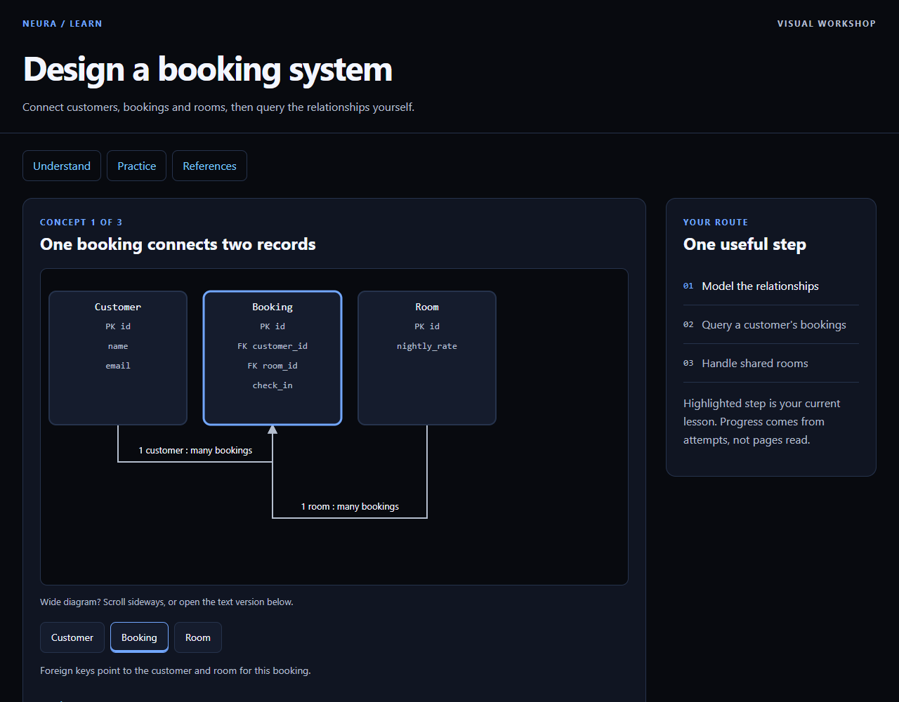
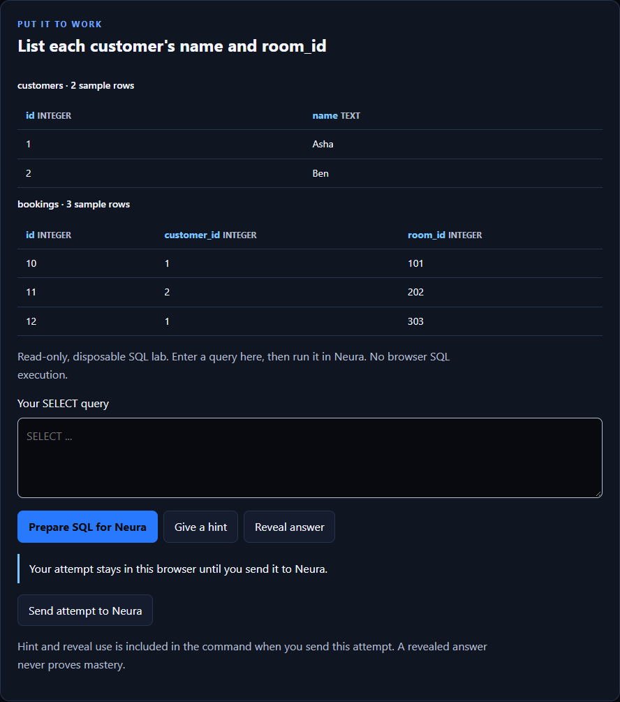
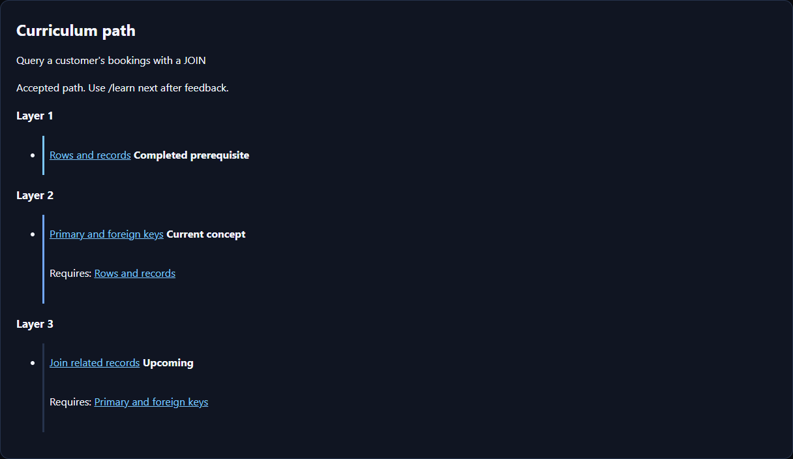

# Learn Mode

The active Mastra Learn service teaches through local documents, visual boards
and practical exercises. The instructional controller adds explicit phases,
learner-approved prerequisite paths and concept-scoped evidence to the
continuity/vault hardening in #153. Development/testing uses synthetic, non-sensitive materials.
[Distribution and production gates](STATUS.md) remain open.

## Visual tour

### Understand one idea



Use concept highlights, a text alternative, a worked example and progressive hints.
The route at the right describes the lesson; reading a page does not mark it complete.

### Try a query



The browser prepares a revision-bound command. Paste it into the current Neura
session for bounded SQLite evaluation; SQL does not execute in the browser.
Choice and keyed short-answer exercises can show local feedback, but only terminal
submission records an attempt in Neura.

### Follow prerequisites



Accepted paths show prerequisite layers, the current concept and upcoming practice.
Progress is practice evidence, not certification.

These are unretouched native Edge screenshots of the current renderer, captured
on 2026-11-08 with **synthetic fixtures**. The desktop view is 1280 × 1000; the SQL
and curriculum views capture their complete panels at the same desktop scale.
Names, tables, source identifiers and the displayed PDF citation are examples—not
private learner data, a real document import or live model-inference evidence.
[Capture provenance and reproduction](../assets/screenshots/README.md).

## Start a lesson

Launch Neura in a disposable workspace with a configured provider, then enter:

```text
/mode learn
Teach database joins using materials/joins.pdf. Show one diagram and an example, then give me an exercise.
```

Use an ordinary workspace PDF, PPTX, HTML, text, Markdown or C/C++ file that you
created for testing. The tutor imports it before citing page/slide excerpts,
publishes a diagnostic card or proposes a path, then waits. Accept a proposed path
with `/learn accept-plan`. Teach cards carry a worked example and common mistakes,
plus a diagram when the idea has structure or steps. Probe and check cards can stay
compact. Progressive hints are available. Teaching cards can stay open-ended;
check, practice and review cards must be automatically graded.

Each card prints in chat as plain text: goal, bullets, the diagram's nodes and
edges, worked example, question and options. Neither the terminal nor T3 draws the
diagram itself. Open the `file://` board link for the visual version. Browser
controls copy revision-bound commands. Submit them in the terminal. There is **no automatic browser synchronization**.
A command from an old lesson revision is rejected. Worked answers are visible
in board source, so boards support self-study rather than examination security.

## Commands and persistence

| Command | Result |
| --- | --- |
| `/learn status` | Current phase, wait condition, scoped evidence and board path |
| `/learn path` | Bounded topological curriculum list and board path |
| `/learn accept-plan` | Accept the proposed prerequisite DAG and begin teaching |
| `/learn next` | Continue after evaluated feedback. Failed checks require remediation |
| `/learn answer <text or SQL>` | Submit the learner's actual answer |
| `/learn answer-helped <text or SQL>` | Record an assisted attempt |
| `/learn hint`, `/learn reveal` | Progressive help with assistance recorded |
| `/learn explain`, `/learn deeper`, `/learn example` | Ask for clarification without advancing |
| `/learn save` | Explicitly save lesson state and progress |
| `/learn saved` | List up to 100 recent snapshots |
| `/learn resume <filename>` | Explicitly restore a saved snapshot |
| `/learn reset` | Clear current in-memory learning state without deleting saves |

Snapshots restore phases, wait conditions, pending/accepted paths, completed
practice, lesson content, attempts, next hint, assistance, tutor notes and next step. Images are omitted. Restored excerpts remain
historical/unverified until the original document is reimported. New citations
require that reimport. Attempts bind to `(pathRevision, conceptId, stepId,
exerciseRevision)`. Different lessons, phases, steps, questions or paths cannot
reuse an earlier attempt as current evidence. Legacy version-1 snapshots migrate
without trusting their lesson-ID-only attempts. Those remain historical. Reading, revealing or answering correctly does not prove mastery.
Each attempt also keeps a bounded copy of what was asked, so a resumed tutor can
avoid repeating an earlier scenario. The fresh-scenario and single-correct-option
rules are prompt instructions, which the application cannot verify.

New conversations do not silently load learning content. `/resume <id>` restores
conversation history in Work. Use `/mode learn` and `/learn resume <filename>`
to restore a lesson separately. `--no-history` affects conversations, not Learn
artifacts. There is no automatic progress snapshot save.

## Instructional controller

Application code owns `probe`, `plan`, `teach`, `check`, `practice` and `review`.
Publishing a card sets `awaiting-answer`. Evaluation sets `awaiting-continuation`
and cannot publish or advance another card. Only `/learn next` releases that
boundary. Failed checks and practice return to teaching before another check.
A revealed answer can teach, but it cannot pass a check or finish a concept. Check,
practice and review cards without an automatic answer key are refused, because they
could only loop back to teaching. Open-ended teaching remains ungraded and is not mastery.

`learn_path` can propose a route before a diagnostic when assessment is unnecessary.
The learner must still accept it. Paths contain at most 24 concepts and 48 directed
prerequisite edges. The controller rejects cycles, duplicate/unknown edges and
nodes that do not contribute to the target. Topological layers use stable ID order.
The controller selects the next available concept only after review. Model output
cannot skip prerequisites or select a later instructional phase. Path completion
records practice, not certified competence.

The HTML board shows layers, current concept, prerequisites and upcoming concepts
with text statuses and keyboard links. `/learn path` uses plain, width-bounded text,
including with `NO_COLOR`. Browser controls do not authorize transitions.

## Tools and document boundary

The model receives `learn_material`, `learn_path`, `learn_lesson`, `learn_exercise`
and `learn_progress`, plus bounded public-workspace `read`/`ls`. Learn exposes no
generic write/edit, shell, `grep`/`find`, web search, integration or Plan tool.
Publishing a card, proposing a path or evaluating an attempt ends the model turn. Model-generated
answers cannot substitute for the learner's actual latest input.

Page images stay in conversation history only for the turn that read them. The tutor
reads a page again when it needs the image later.

HTML notes, text, Markdown and C/C++ source import as inert UTF-8 text, split into
numbered sections cited as pages. HTML loses scripts, styles and layout.
Document import checks captured bytes, source identity and excerpt locations.
These checks validate citation identity, not the truth of the tutor's explanation.
OCR is offline English and can misread formulas or handwriting. Export legacy
`.ppt` and full PowerPoint layouts to PDF/PPTX as described in the
[document runtime review](LEARN_DEPENDENCIES.md). Limits include 12 materials per
session, 25 MiB and 100 pages/slides per file.

Short keyed answers ignore spacing and case, and treat `3/8`, `0.375` and `37.5%`
as equal. Decimals with at least three significant digits may be rounded. Choice
answers use the option number, or the value when options are bare numbers. SQL exercises use bounded,
disposable in-memory SQLite with sample tables, no host file/network access and
no `ATTACH` or writes. Grading compares columns and duplicate rows, ignores row
ordering and refuses to grade truncated output. Open-ended work has no automatic score.

## Workspace store

Boards, assets and explicit snapshots live beneath owned `.neura-learning/` with
a marker and Git exclusion. First creation requires native Windows. It refuses
an existing unowned directory. Existing validated stores can be used on POSIX,
but that does not establish a supported Linux installation. Never delete an
unowned directory to bypass the refusal.

Writers use bounded exclusive files and canonical path/handle checks. Unpublished
metadata-only initialization directories can remain after interruption. These
are application controls, not OS isolation against another process running as
the same user. Parser deadlines and heap limits likewise do not sandbox native/WASM code.

## Optional Obsidian capture

Capture is disabled by default. Configure `NEURA_LEARN_VAULT` with an absolute,
local, non-UNC vault path, or put this private file at
`~/.neura/learn-vault.json` (under `NEURA_HOME` when explicitly set):

```json
{"version":1,"vault":"C:\\path\\to\\test-vault"}
```

The directory must already contain a real `.obsidian/`. Linked roots are refused. Mapped/network-backed volumes are unsupported. The active service does not read
the old Pi profile's vault configuration.

Only the vault's marked `Neura/` subtree is writable. Capture adds bounded
concept/practice/tutor/preference events in immutable numbered JSON envelopes
under `Neura/_System/events/`. Stable Markdown knowledge notes live under
`Neura/Topics/` and `Neura/Concepts/`. Dated event projections and learner findings
remain available. It omits raw answers and full transcripts.
User-edited or ambiguous files are preserved rather than overwritten. The store
holds at most 2,000 events. Integrity hashes detect ordinary edits, not a malicious
same-user rewrite. Content is plaintext. Obsidian or its plugins may sync it independently.

Recognized teaching preferences require evidence from two distinct exact learner
messages before affecting later prompts. Profiles remain bounded, untrusted data
and cannot widen policy. This is prompt conditioning, not model training.
Vault metadata caps topics at 120 characters without shortening lesson titles
accepted up to 160 characters. Event envelopes retain version-1 compatibility and now carry evidence identities,
content-hashed propositions and typed relations. Identical normalized claims share
a stable note within a concept, not across concepts. Relations use `requires`,
`supports`, `example-of`, `contradicts` and `supersedes` Markdown wikilinks.
`learn_progress` exposes proposition IDs and accepts tutor-authored propositions
with relations. Corrections must supersede an existing different claim in the same
concept and cannot create correction cycles. Old claims remain as history. New
relations get immutable notes rather than overwriting user edits.

The event cap, bounded claim/relation counts and exclusive writes bound projection
growth. The active workspace remains authoritative: vault contents cannot advance
phases, satisfy checks or change prerequisites.

A current-session vault failure warns while learning continues. Stale operations
cannot publish state or warnings into a later session. A completed disk/vault write
can remain after cancellation. There is no transaction across both stores.
`/learn save` remains the explicit recovery source.

## Implementation and checks

`src/learn.ts` and `src/learn-state.ts` own active service/session behavior. Shared
`agent/neura/learn-*` modules own parsing, rendering, exercises, file/snapshot handling
and vault storage. The retained Pi extension is not loaded by Mastra.

```powershell
node scripts/verify-harness.mjs --suite learn
npm run test:learn
npm run test:browser:learn
```

The active suite includes fresh-process recovery, actual-answer provenance,
configured-vault title bounds, historical citations and delayed-I/O state fences.
Pedagogy regressions cover DAG bounds, transition refusals, remediation,
version-1 migration, scoped attempts, explicit plan acceptance, full path completion
and stable knowledge links. Shared suites retain parser attacks, OCR, SQL, storage
races and vault integrity.
Browser checks cover keyboard, narrow layouts, CSP and accessibility in Edge.
See [dated evidence](MASTRA_V1.md#learn-acceptance). These checks do not close all
of #123 or establish production readiness.
